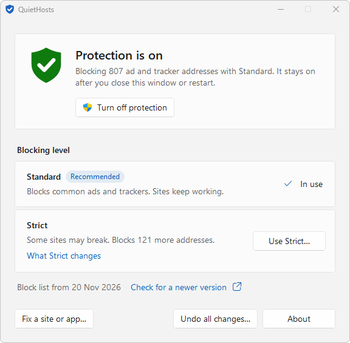

# QuietHosts

<!--
  Links point to these headings, so keep their wording exactly:
  - QuietHosts itself (src/QuietHosts/Strings.cs): "If something goes wrong", "Verify your download",
    "QuietHosts won't change your hosts file" and "Windows Defender reports HostsFileHijack".
  - The release notes (.github/workflows/release.yml): "If Windows warns you".
  - CONTRIBUTING.md and SECURITY.md: "What it does", "Download and start", "Verify your download",
    "Update QuietHosts" and "Open the hosts file as administrator".
  The address counts under "What it does" and the example block under "How it works" are checked before every release:
  change their numbers only as CONTRIBUTING.md describes.
-->

Free, open-source ad and tracker blocking for your whole Windows PC, using the hosts file.

[](https://github.com/quiethosts/QuietHosts/actions/workflows/ci.yml)
[](https://github.com/quiethosts/QuietHosts/releases)
[](LICENSE)
[](#download-and-start)

<picture>
  <source media="(prefers-color-scheme: dark)" srcset="docs/images/main-on-dark.png">
  <source media="(prefers-color-scheme: light)" srcset="docs/images/main-on-light.png">
  
</picture>

**[Download QuietHosts](https://github.com/quiethosts/QuietHosts/releases/latest)** · [User guide](docs/README.md) · [FAQ](docs/faq.md) · [If something goes wrong](#if-something-goes-wrong) · [Uninstall](#uninstall)

## What it does

QuietHosts blocks ad and tracker addresses for every browser and app on your PC. It adds them to the Windows hosts file and points them nowhere (0.0.0.0), so browsers and apps on this PC can't load them.

You choose a level:

- **Standard (recommended)** blocks 807 ad and tracker addresses, picked so that sites, sign-ins, payments and games keep working.
- **Strict** blocks 121 more, 928 in all. Some things may stop working:
  - Links in ads, sponsored Google results and shopping emails may not open.
  - Some videos, "Recommended stories" boxes and product boxes may stay empty.
  - Some sites show "ad blocker detected" or have broken buttons, forms or checkout.
  - Some apps, developer tools and ad or analytics dashboards may show errors.

  You can switch back to Standard at any time.

Good to know:

- It works in every browser and app, but it can't block every ad. Use it alongside an ad-blocking browser extension. See [What it can't block](#what-it-cant-block).
- If a site or app stops working, **Fix a site or app…** helps you find out why. You can allow single addresses there.
- Nothing runs in the background. Blocking keeps working after you close QuietHosts, and after a restart.
- QuietHosts never goes online and collects nothing. No ads, no tracking, no account.
- **Undo all changes…** takes QuietHosts' lines out of the hosts file and deletes its settings, with one Windows prompt. The backups of your hosts file stay.

## Download and start

You need Windows 10 (version 1903 or later) or Windows 11. There is nothing to install: QuietHosts is a single file. It uses .NET Framework 4.8, which is part of Windows.

1. Open the [latest release](https://github.com/quiethosts/QuietHosts/releases/latest) and download **QuietHosts.exe**. Download it only from that page.
2. If your browser warns you, see [If Windows warns you](#if-windows-warns-you).
3. Check your download. See [Verify your download](#verify-your-download).
4. Make a folder of its own for QuietHosts, for example a new folder named QuietHosts in Documents. Move QuietHosts.exe there. Don't start it from Downloads or from inside a zip file. A folder of its own is safer, because QuietHosts gets administrator rights for each change.
   - If this PC has standard accounts, or your account isn't an administrator, put QuietHosts.exe in a folder that only administrators can change instead, such as `C:\Program Files\QuietHosts`. Programs running on a standard account can change the files in that account's folders, and Windows starts whatever QuietHosts.exe is in the folder when you say yes to its prompt.
5. Double-click QuietHosts.exe.
6. Click **Turn on protection**. Windows asks for your permission. Say yes only if it names QuietHosts.exe and you just clicked a QuietHosts button.
7. Restart your browser: close all its windows, then open it again. That way it forgets the old addresses.

The hosts file is a protected Windows file, so Windows asks for permission before every change. If your account isn't an administrator, an administrator's password is needed. [Getting started](docs/getting-started.md) shows every step, with pictures.

## If Windows warns you

QuietHosts isn't signed yet, and each new version starts without a reputation with Microsoft. So your browser and Windows may warn you about it. Signed builds are planned.

**Your browser says QuietHosts.exe isn't commonly downloaded.** Choose **Keep**. In Edge, Keep is in the **...** menu next to the download. If Edge asks again, click **Show more**, then **Keep anyway**.

**Windows says "Windows protected your PC".**

1. [Verify your download](#verify-your-download) first.
2. Click **More info**.
3. Check that it says **App: QuietHosts.exe**.
4. Click **Run anyway**.

**Windows says "Unknown publisher" when you click a button.** Before every change, Windows asks whether QuietHosts may make changes to your device. It says "Unknown publisher" because QuietHosts isn't signed yet. Say yes only if it names QuietHosts.exe and you just clicked a QuietHosts button. If you say no, nothing is changed.

**Smart App Control blocks QuietHosts.** On Windows 11, Smart App Control blocks unsigned apps that have no reputation yet, and it has no Run anyway button. Then QuietHosts can't run on that PC for now. We don't recommend turning Smart App Control off for it.

## Verify your download

Each release has a file named SHA256SUMS.txt. It holds the SHA-256 hash of QuietHosts.exe: a long code that changes if even one byte of the file changes.

1. Click Start, type **PowerShell** and open it.
2. Run this command. It expects the file in your Downloads folder.

   ```
   Get-FileHash "$env:USERPROFILE\Downloads\QuietHosts.exe" -Algorithm SHA256
   ```

   In Command Prompt, use this command instead:

   ```
   certutil -hashfile "%USERPROFILE%\Downloads\QuietHosts.exe" SHA256
   ```

3. Compare the result with the QuietHosts.exe line in SHA256SUMS.txt. GitHub also shows it next to the file on the release page. Case doesn't matter.
4. If they differ, don't run the file. Delete it and download it again.

The hash catches broken or swapped downloads. It can't catch a hijacked GitHub account, because whoever controls the account could change both files.

The attestation is stronger. It proves that this repository's GitHub Actions built the file from its public source code. To check it, install the [GitHub CLI](https://cli.github.com/) and sign in with `gh auth login`. Then, in the folder that holds QuietHosts.exe, run:

```
gh attestation verify QuietHosts.exe -R quiethosts/QuietHosts --signer-workflow quiethosts/QuietHosts/.github/workflows/release.yml
gh release verify-asset vX.Y.Z QuietHosts.exe -R quiethosts/QuietHosts
```

Replace vX.Y.Z with the version you downloaded, for example v1.0.0. The first command also checks that the release workflow built the file. The second checks that the file is the one attached to that release.

## User guide

The [user guide](docs/README.md) explains every part of QuietHosts in plain words:

- [Getting started](docs/getting-started.md): download, check the file, the Windows warnings and prompts, and turning protection on.
- [Blocking levels](docs/blocking-levels.md): Standard and Strict, and what Strict can break.
- [Fix a site or app](docs/fix-a-site.md): what to do when a site stops working, and how to allow single addresses.
- [Notices and messages](docs/notices.md): every message QuietHosts shows, and what to do.
- [Troubleshooting](docs/troubleshooting.md): antivirus prompts, Windows Defender, backups and more.
- [Update QuietHosts](docs/update.md), [How it works](docs/how-it-works.md), [Uninstall](docs/uninstall.md) and the [FAQ](docs/faq.md).

## Update QuietHosts

QuietHosts never updates itself. New versions, with new block lists, come out on the [releases page](https://github.com/quiethosts/QuietHosts/releases).

1. In QuietHosts, click **Check for a newer version**. It opens the releases page in your browser. If there is a newer version, download QuietHosts.exe from it and [verify it](#verify-your-download).
2. Close QuietHosts. Then replace the old QuietHosts.exe in its folder with the new one.
3. Start QuietHosts. If it says "This copy of QuietHosts has a newer block list", click **Use newer list** in that notice. That is one Windows prompt. Protection stays on, and your level and allowed addresses are kept. Until you do, your hosts file keeps the old list.

[Update QuietHosts](docs/update.md) has more, such as what to do when QuietHosts says your hosts file has a newer list.

## How it works

QuietHosts adds one block of lines to the Windows hosts file, `C:\Windows\System32\drivers\etc\hosts`. Windows reads this file before it looks up an address on the internet. A line such as `0.0.0.0 1x1.a-mo.net` sends that address nowhere, so it can't load in any browser or app.

The block looks like this:

```
# >>> QuietHosts >>>
# Managed by QuietHosts: use the app to change these lines. https://github.com/quiethosts/QuietHosts
# QuietHosts 1.0.0 | level=standard | lists=2026-11-20 | hosts=807 | sha256=…
0.0.0.0 1x1.a-mo.net
0.0.0.0 …
# <<< QuietHosts <<<
```

- **Your own lines stay.** QuietHosts changes only its own block. Lines that you or other programs added stay exactly as they are.
- **One permission prompt per change.** The QuietHosts window runs without administrator rights. For each change, it starts a hidden copy of itself with administrator rights. That copy makes the one change and closes.
- **A backup before every change.** QuietHosts saves a copy of the hosts file in the same folder. Then it writes the new file, reads it back, and checks it again 2 seconds later. If the change didn't stick, it tells you, and it puts the old file back if needed.
- **Nothing runs in the background.** Windows itself reads the hosts file, so blocking keeps working after you close QuietHosts, and after a restart.
- **Some addresses are never blocked:** Microsoft addresses, and services that sign-in, payments, captchas and security updates need. A list built into the app and [lists/guard.txt](lists/guard.txt) protect them.

[How it works](docs/how-it-works.md) explains the rest, including where QuietHosts keeps its settings.

## What it can't block

YouTube video ads, Twitch stream ads and sponsored posts on social sites come from the same servers as the videos and posts, so blocking them would break those sites. For those, use an ad-blocking browser extension such as uBlock Origin Lite (Chrome, Edge) or uBlock Origin (Firefox). It works well alongside QuietHosts.

A hosts file also blocks exact addresses only, can't hide empty ad boxes, and has no effect when a browser or app uses a proxy. QuietHosts never blocks Microsoft addresses, because Windows Defender resets hosts files that block them.

## If something goes wrong

The [troubleshooting guide](docs/troubleshooting.md) covers every problem and message. The most common ones:

- **A site or app stopped working:** click **Fix a site or app…** in QuietHosts and try its steps in order. See [Fix a site or app](docs/fix-a-site.md).
- **Ads still show:** restart your browser first. See [Ads still show](docs/troubleshooting.md#ads-still-show).
- **Your antivirus asks about QuietHosts, or QuietHosts says "Your antivirus or Windows blocked the change":** see [Your antivirus asks about QuietHosts or blocks the change](docs/troubleshooting.md#your-antivirus-asks-about-quiethosts-or-blocks-the-change).
- **QuietHosts says "Protection was removed":** see [Protection was removed](docs/troubleshooting.md#protection-was-removed).
- **QuietHosts says "QuietHosts is already changing the hosts file":** see [QuietHosts is already changing the hosts file](docs/troubleshooting.md#quiethosts-is-already-changing-the-hosts-file).
- **Your last change didn't finish:** click **Repair** in that notice. See [A change didn't finish](docs/troubleshooting.md#a-change-didnt-finish).
- **You want your old hosts file back:** see [Restore a backup](docs/troubleshooting.md#restore-a-backup).
- **Something in QuietHosts doesn't work:** see [Report a problem](docs/troubleshooting.md#report-a-problem).

### QuietHosts won't change your hosts file

QuietHosts refuses to change the hosts file when that isn't safe, and it tells you why. The headline says "QuietHosts won't change your hosts file" or, for the file format, "QuietHosts can't change your hosts file":

- **Windows is set to use a hosts file in another folder.** Malware sometimes does this, so QuietHosts leaves it alone. Check your PC with your antivirus. The setting is the DataBasePath value in `HKEY_LOCAL_MACHINE\SYSTEM\CurrentControlSet\Services\Tcpip\Parameters`.
- **The file is saved in a format QuietHosts can't change safely, such as UTF-16.** [Open it in Notepad as administrator](#open-the-hosts-file-as-administrator). Choose **File > Save as**, set the encoding to **UTF-8** and the type to **All files**, and save it as `hosts`. Then click **Check again**.
- **The file is larger than 16 MB.** Another program probably added a very large list. Remove that list, or [restore a backup](docs/troubleshooting.md#restore-a-backup). Then click **Check again**.

### Windows Defender reports HostsFileHijack

Windows Defender reports SettingsModifier:Win32/HostsFileHijack when the hosts file blocks Microsoft addresses. QuietHosts never blocks them, but another program, or an old edit, may have. Defender may then reset the whole hosts file, including QuietHosts' lines. QuietHosts then says "Protection was removed".

1. [Open the hosts file as administrator](#open-the-hosts-file-as-administrator).
2. Look for lines that don't start with `#` and block one of Microsoft's own services, for example an address ending in microsoft.com, windows.com, windowsupdate.com, live.com or bing.com. They are usually outside the QuietHosts block; QuietHosts never adds them itself. QuietHosts warns about the lines that can make Defender reset the file: "Another program added lines that block Microsoft addresses. Windows Security may reset your hosts file because of them, which also removes QuietHosts." Click **Show lines** in that notice to see them (and copy them); its **How to remove them** link opens this section. It doesn't warn about lines for names that ad and phishing lists often block, such as adnxs.com, GitHub pages or sites hosted on Azure (azurewebsites.net).
3. Delete those lines and save. If a program added them, it may add them again, so consider removing that program.
4. In QuietHosts, click **Turn on again**.

### Open the hosts file as administrator

1. Click Start and type **Notepad**.
2. Right-click **Notepad**, choose **Run as administrator** and click **Yes**.
3. In Notepad, choose **File > Open**.
4. In **File name**, paste `C:\Windows\System32\drivers\etc\hosts` and click **Open**.

After you save a change, run `ipconfig /flushdns` in Command Prompt and restart your browser.

## Uninstall

Click Undo all changes, then delete QuietHosts.exe.

1. In QuietHosts, click **Undo all changes…**, then **Remove everything**. When Windows asks for your permission, say yes only if it names QuietHosts.exe. This takes QuietHosts' lines out of the hosts file and deletes its settings from the registry. Lines added by you or other programs stay.
2. Restart your browser.
3. Delete QuietHosts.exe.

The backups of your hosts file stay next to it, in case you need them. [Uninstall](docs/uninstall.md) shows how to delete them, and how to remove QuietHosts' lines if you no longer have the app.

## Privacy

QuietHosts never goes online. It has no telemetry, analytics, ads or accounts. It changes only the hosts file (keeping a backup next to it) and its own settings in the registry.

Links in QuietHosts, such as **Check for a newer version** and **Report a problem**, open in your web browser.

## Sources and thanks

QuietHosts' block list is our own. Each address was reviewed one by one and checked against public lists by Steven Black, HaGeZi, OISD, AdGuard, Peter Lowe and the EasyList authors. Thank you to their maintainers. QuietHosts doesn't include or download their lists. See [CREDITS.md](CREDITS.md).

## Contributing

- Found a site that QuietHosts breaks? [Report it](https://github.com/quiethosts/QuietHosts/issues/new?template=site-broke.yml).
- Want to suggest or move an address? Read [CONTRIBUTING.md](CONTRIBUTING.md). Pull requests change only the lists in `lists/`, and list changes ship with the next version of QuietHosts.
- To build QuietHosts yourself, you need Windows and the .NET 10 SDK (10.0.404 or a later 10.0.4xx). Run `dotnet build QuietHosts.slnx`, then `dotnet test QuietHosts.slnx`.
- Need help? [SUPPORT.md](SUPPORT.md) lists where to ask. Everyone who takes part follows the [code of conduct](CODE_OF_CONDUCT.md).

## Security

Please report security problems privately. See [SECURITY.md](SECURITY.md).

## License

QuietHosts is free and open source under the [MIT License](LICENSE). Copyright (c) 2026 QuietHosts contributors.
