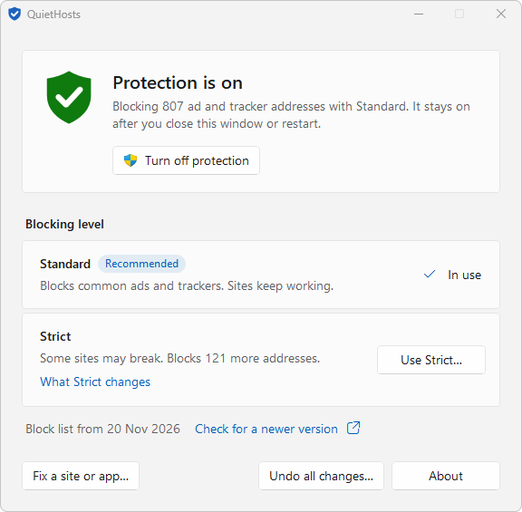
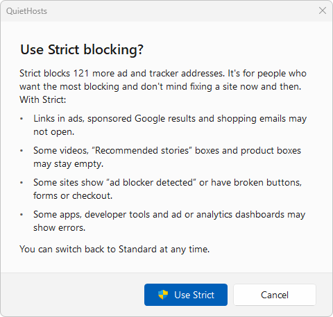

# Blocking levels

QuietHosts has two levels: **Standard** and **Strict**. You can switch between them at any time, and your allowed addresses are kept when you do.

[User guide](README.md) › Blocking levels

## Standard

The card says "Blocks common ads and trackers. Sites keep working." and carries the tag **Recommended**.

Standard blocks ad and tracker addresses that are picked so that sites, sign-ins, payments and games keep working. Every address was reviewed one by one, and Standard holds only the ones with no known breakage: blocking them should cost a page only its ads, ad slots, tracking and "around the web" boxes. If a site breaks anyway, [Fix a site or app](fix-a-site.md) helps you find out why, and a report helps move the address out of Standard for everyone in a later version.

Use Standard unless you want the most blocking and don't mind fixing a site now and then.

## Strict

The card says "Some sites may break." and how many more addresses Strict blocks.

Strict blocks everything Standard blocks, plus addresses that are known to break something on some sites or apps. It's for people who want the most blocking and don't mind fixing a site now and then.

### What Strict can break

With Strict:

- Links in ads, sponsored Google results and shopping emails may not open.
- Some videos, "Recommended stories" boxes and product boxes may stay empty.
- Some sites show "ad blocker detected" or have broken buttons, forms or checkout.
- Some apps, developer tools and ad or analytics dashboards may show errors.

You can switch back to Standard at any time. **What Strict changes** on the Strict card shows this list in QuietHosts.

## The level cards

The **Blocking level** section of the main window has one card for each level.

<picture>
  <source media="(prefers-color-scheme: dark)" srcset="images/main-on-dark.png">
  <source media="(prefers-color-scheme: light)" srcset="images/main-on-light.png">
  
</picture>

The right side of each card tells you where you are:

| The card shows | It means |
|---|---|
| **In use** | Protection is on and your hosts file has this level. |
| **Selected** | Protection is off (or QuietHosts can't read or change your hosts file). QuietHosts uses this level when you turn protection on. |
| **Use Strict…** | Click it to switch to Strict. QuietHosts first shows what Strict changes. |
| **Use Standard** | Click it to switch back to Standard. |

## Switch to Strict

1. On the Strict card, click **Use Strict…**.
2. QuietHosts asks "Use Strict blocking?" and lists what may stop working. Read it.
3. Click **Use Strict**, or **Cancel** to keep Standard.
4. If protection is on, Windows asks for your permission. Say yes only if it names QuietHosts.exe. QuietHosts then says "You're now using Strict. Restart your browser to see the change." Restart your browser.

   If protection is off, nothing more happens now: the Strict card shows **Selected** (see [below](#choose-a-level-while-protection-is-off)).

<picture>
  <source media="(prefers-color-scheme: dark)" srcset="images/strict-confirm-dark.png">
  <source media="(prefers-color-scheme: light)" srcset="images/strict-confirm-light.png">
  
</picture>

## Switch back to Standard

1. On the Standard card, click **Use Standard**. There is no question first: Standard is the safe choice.
2. If protection is on, say yes to the Windows prompt if it names QuietHosts.exe. QuietHosts then says "You're now using Standard. Restart your browser to see the change." Restart your browser.

   If protection is off, the Standard card simply shows **Selected**.

If a site broke while you used Strict, **Fix a site or app…** offers the same switch as its second step (see [Try Standard](fix-a-site.md#try-standard)).

## Choose a level while protection is off

While protection is off, choosing a level changes nothing in your hosts file, so Windows doesn't ask for permission. QuietHosts only remembers your choice, and the card shows **Selected**. The next time you click **Turn on protection** in the main window, QuietHosts uses that level.

The first screen's **Turn on protection** always uses Standard.

## When the level can't be changed

While QuietHosts can't read or change your hosts file, the **Blocking level** section says "You can change the level when QuietHosts can change your hosts file." and the buttons are greyed out. The status card above says why, and [Troubleshooting](troubleshooting.md) explains what to do.

The buttons are also greyed out while a change runs. They come back when it ends.
