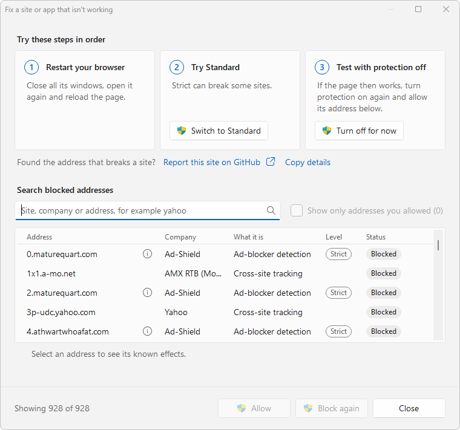
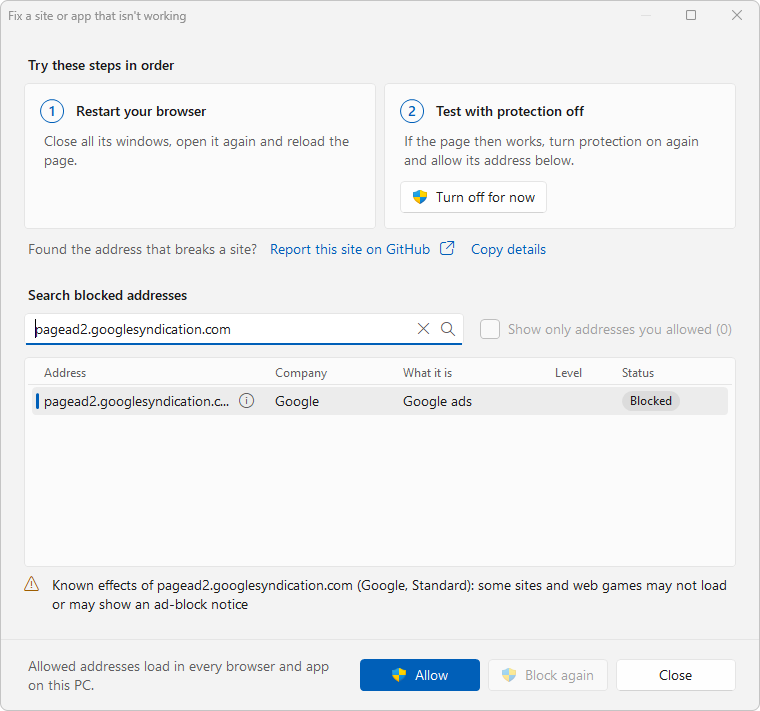
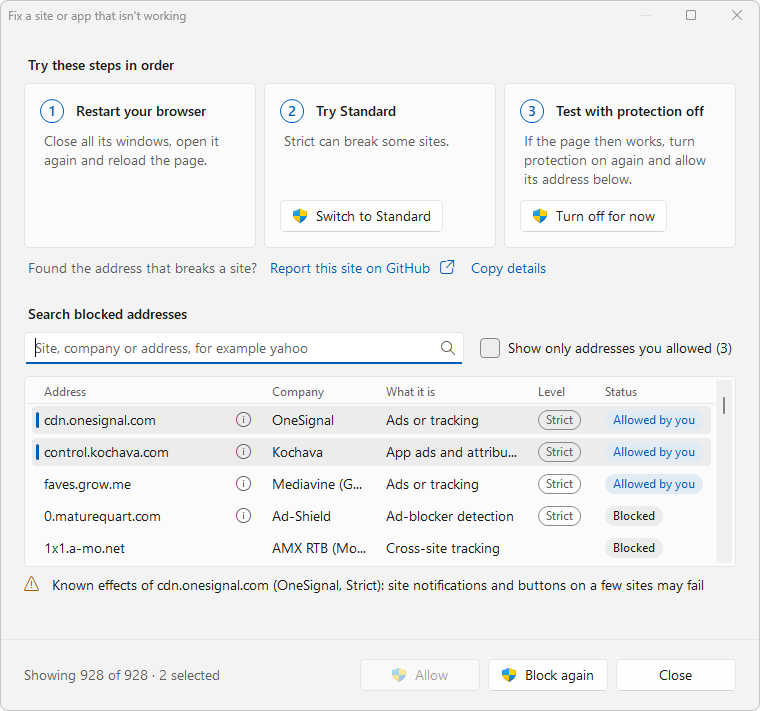

# Fix a site or app

If a site or app stops working after you turn on QuietHosts, **Fix a site or app…** helps you find out whether QuietHosts is the cause. If it is, you can allow just the addresses that the site needs, and block them again later.

[User guide](README.md) › Fix a site or app

## Open the Fix window

In the main window, click **Fix a site or app…** (bottom left). The window "Fix a site or app that isn't working" opens. Its steps at the top change with the state of protection and your level.

<picture>
  <source media="(prefers-color-scheme: dark)" srcset="images/fix-dialog-dark.png">
  <source media="(prefers-color-scheme: light)" srcset="images/fix-dialog-light.png">
  
</picture>

Try the steps in order. With Standard there are two; with Strict there are three.

## Restart your browser

Close all its windows, open it again and reload the page.

Browsers remember addresses for a few minutes. Right after a change in QuietHosts, a page may still use the old ones, so a restart comes first.

## Try Standard

This step shows only while you use Strict, because Strict can break some sites.

1. Click **Switch to Standard**.
2. Say yes to the Windows prompt if it names QuietHosts.exe.
3. Restart your browser and reload the page.

If the page works now, you can stay with Standard. The [Blocking levels](blocking-levels.md#what-strict-can-break) page lists what Strict can break.

## Test with protection off

This step shows whether QuietHosts is the cause.

1. Click **Turn off for now**.
2. Say yes to the Windows prompt if it names QuietHosts.exe.
3. Restart your browser and reload the page.
4. Then:
   - **If the page works now,** QuietHosts is the cause. Click **Turn on again** (the same button now has this name), then [allow the address](#allow-an-address) that the page needs.
   - **If it's still broken,** QuietHosts isn't the cause. Click **Turn on again** to turn protection back on.

While protection is off after this test, the main window says "You turned it off to test a site. Turn it on again when you're done." That is the only reminder, and it goes when you close QuietHosts.

### When the last step looks different

The last card fits the state of protection:

| The card says | What to do |
|---|---|
| **Protection is off**: "QuietHosts isn't blocking anything now. If the page still doesn't work after you restart your browser, QuietHosts isn't the cause." | Restart your browser. If the page still doesn't work, look for the cause elsewhere. **Turn on protection** (or **Turn on again**) turns protection back on. |
| **Protection is off**: "If the page works now, turn protection on again and allow its address below." | You turned protection off with **Turn off for now**. Click **Turn on again**, then allow the address. |
| **Replace the older list**: "Your hosts file still has the block-ads.ps1 list, which can cause this." | Click **Turn on**. QuietHosts replaces the older list with its own. |
| **QuietHosts can't change your hosts file right now**: "Close this window and follow the main window." | Close the window. The main window says what's wrong; [Troubleshooting](troubleshooting.md) explains each case. |

## Allow an address

You can allow or block addresses only while protection is on. While it's off, the window says "Turn protection on to allow or block addresses."

1. Click in **Search blocked addresses** (or press Ctrl+F) and type the name of the site or app, a company, or part of an address. The box suggests "Site, company or address, for example yahoo". The list shows what matches.
2. Click an address. The line under the list shows what blocking it may break, for example "Known effects of ads.example.com (Example, Standard): …". "None known" means that no problem is known.
3. Select the addresses you want to allow. Hold Ctrl to select more than one, or press Ctrl+A to select every address the list shows. The line next to **Allow** now says "Allowed addresses load in every browser and app on this PC."
4. Click **Allow**.
5. Say yes to the Windows prompt if it names QuietHosts.exe.
6. QuietHosts says "Allowed 2 addresses. Restart your browser, then reload the page." (with your number).
7. Restart your browser and reload the page.

<picture>
  <source media="(prefers-color-scheme: dark)" srcset="images/fix-allow-dark.png">
  <source media="(prefers-color-scheme: light)" srcset="images/fix-allow-light.png">
  
</picture>

Allowed addresses stay allowed until you block them again, also when you switch levels or turn protection off and on. **Undo all changes…** forgets them.

### Search tips

- The search looks at the address, the company, "What it is" and the known effects. Upper and lower case don't matter.
- The list holds ad and tracker addresses, not the sites you visit. If QuietHosts says "No blocked address matches “example-shop”." and "Searching for a website? Test with protection off instead.", go back to [Test with protection off](#test-with-protection-off). The link **Go to step 2** (or 3) takes you to that step's button.
- Not sure which address the site needs? Search for the site's name or its company and allow what the search finds, then test. If that fixed it, you can block them again one by one to find the one that matters.
- Allow as few addresses as you can: every allowed address loads in every browser and app on this PC.
- You can allow up to 100 addresses at a time. With more selected, the window says "Select up to 100 addresses at a time."

## Block an address again

1. Check **Show only addresses you allowed (3)** (the number is how many you allowed), or search for the address.
2. Select the addresses whose status is **Allowed by you**.
3. Click **Block again**.
4. Say yes to the Windows prompt if it names QuietHosts.exe.
5. QuietHosts says "Blocked 2 addresses again. Restart your browser to see the change." (with your number).

<picture>
  <source media="(prefers-color-scheme: dark)" srcset="images/fix-block-again-dark.png">
  <source media="(prefers-color-scheme: light)" srcset="images/fix-block-again-light.png">
  
</picture>

## Report the site

When you found the address that breaks a site, please tell us, so the list can be fixed for everyone.

1. Click **Copy details**. It copies your QuietHosts version, the block list's version, your Windows build, whether protection is on, your level, how many addresses you allowed (never which ones) and your text size. QuietHosts says "Details copied. Paste them into your report."
2. Click **Report this site on GitHub**. It opens the broken-site form in your browser.
3. Fill in the form and paste the details into **Details from QuietHosts**.

Reports are public. Don't include your name, email address or other personal information. You need a GitHub account to post one.

## The list of addresses

The list shows the addresses your level blocks, plus the ones you allowed. Addresses you allowed come first, then A to Z.

| Column | What it shows |
|---|---|
| **Address** | The address. An **i** icon means it has known effects; point at the row to read them. |
| **Company** | The company behind it, if known. |
| **What it is** | The kind of address, for example "Ad server", "Analytics tracker" or "Cross-site tracking". |
| **Level** | **Strict** for addresses that only Strict blocks. Empty for Standard. |
| **Status** | **Blocked**: it's in QuietHosts' lines in your hosts file. **Allowed by you**: you allowed it. **Not blocked**: QuietHosts' lines don't have it, for example because protection is off. **Unknown**: QuietHosts can't read or change your hosts file, or the older block-ads.ps1 list may block it. |

## Keys

| Key | What it does |
|---|---|
| Ctrl+F | Go to the search box and select its text. |
| Down arrow | From the search box, go into the list. |
| Ctrl+A | In the list, select every address it shows. |
| Alt+A | **Allow** |
| Alt+B | **Block again** |
| Alt+L | **Show only addresses you allowed** |
| Esc | Close the window. |

Press Alt to see the underlined letter of every other button and link. Enter in the search box applies the search at once. Enter never runs the step buttons, so a stray key press can't turn protection off; use Space or a click.

## Window size

You can resize the window or maximize it, and QuietHosts remembers its size. On a small screen the upper part of the window scrolls, and the buttons at the bottom stay in view.
