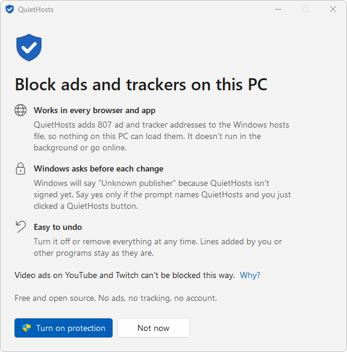
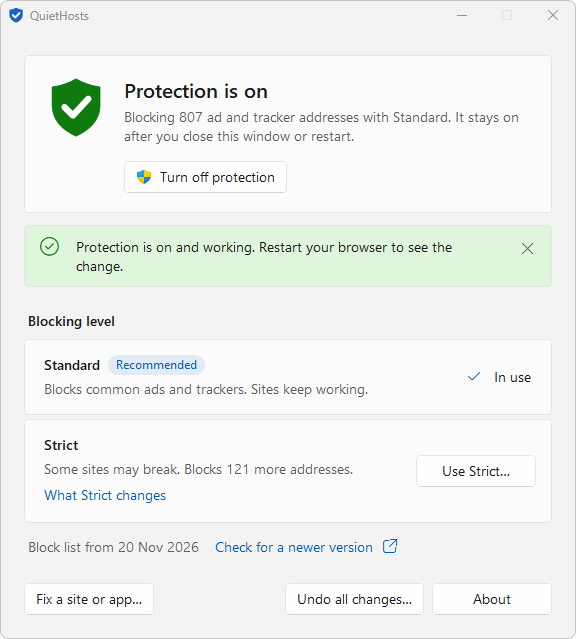

# Getting started

This page takes you from the download to a PC with protection on. It takes a few minutes.

[User guide](README.md) › Getting started

## What you need

- **Windows 10 (version 1903 or later) or Windows 11.** To see your version, press Windows+R, type `winver` and press Enter.
- **Permission to change Windows settings.** The hosts file is a protected Windows file, so Windows asks for your permission before every change. If your account isn't an administrator, an administrator's password is needed.
- **Nothing else.** QuietHosts is a single file with nothing to install. It uses .NET Framework 4.8, which is part of Windows.

## Download QuietHosts

1. Open the [latest release](https://github.com/quiethosts/QuietHosts/releases/latest) on GitHub.
2. Under **Assets**, click **QuietHosts.exe**.

Download QuietHosts only from that page. Copies from other sites may be changed.

### If your browser warns you

QuietHosts isn't signed yet, and each new version starts without a reputation with Microsoft, so your browser may say that QuietHosts.exe isn't commonly downloaded.

- Choose **Keep**.
- In Edge, **Keep** is in the **...** menu next to the download. If Edge asks again, click **Show more**, then **Keep anyway**.

Then check the file, as the next section shows. Signed builds are planned.

## Check your download

Each release has a file named SHA256SUMS.txt. It holds the SHA-256 hash of QuietHosts.exe: a long code that changes if even one byte of the file changes. Checking it tells you that your copy is complete and is the file that was published.

1. Click Start, type **PowerShell** and open it.
2. Run this command. It expects the file in your Downloads folder.

   ```
   Get-FileHash "$env:USERPROFILE\Downloads\QuietHosts.exe" -Algorithm SHA256
   ```

   In Command Prompt, use this command instead:

   ```
   certutil -hashfile "%USERPROFILE%\Downloads\QuietHosts.exe" SHA256
   ```

3. Compare the result with the QuietHosts.exe line in SHA256SUMS.txt. GitHub also shows the hash next to the file on the release page. Case doesn't matter.
4. If they differ, don't run the file. Delete it and download it again.

The hash catches broken or swapped downloads. It can't catch a hijacked GitHub account, because whoever controls the account could change both files.

### The stronger check: the attestation

The attestation proves that this repository's GitHub Actions built the file from its public source code. To check it, install the [GitHub CLI](https://cli.github.com/) and sign in with `gh auth login`. Then, in the folder that holds QuietHosts.exe, run:

```
gh attestation verify QuietHosts.exe -R quiethosts/QuietHosts --signer-workflow quiethosts/QuietHosts/.github/workflows/release.yml
gh release verify-asset vX.Y.Z QuietHosts.exe -R quiethosts/QuietHosts
```

Replace vX.Y.Z with the version you downloaded, for example v1.0.0. The first command also checks that the release workflow built the file. The second checks that the file is the one attached to that release.

## Put QuietHosts in a folder of its own

Each change runs QuietHosts.exe with administrator rights. Your Downloads folder collects files from many places, and Windows could load one of them into QuietHosts. A folder of its own keeps it apart.

1. Open File Explorer and go to **Documents**.
2. Make a new folder named **QuietHosts**.
3. Move QuietHosts.exe from Downloads into that folder.

Don't start QuietHosts from Downloads or from inside a zip file. If you do, QuietHosts shows a tip or a warning about it (see [Notices and messages](notices.md#warnings)).

**If this PC has standard accounts, or your account isn't an administrator,** use a folder that only administrators can change instead, such as `C:\Program Files\QuietHosts`. Windows asks for an administrator's permission when you make that folder and move the file into it. Programs running on a standard account can change the files in that account's own folders, and Windows starts whatever QuietHosts.exe is in the folder when you say yes to its prompt. The [security policy](../SECURITY.md#known-limits) explains this limit.

## Start QuietHosts

Double-click QuietHosts.exe. If QuietHosts is already open, this brings its window to the front.

### If Windows says "Windows protected your PC"

This is Microsoft Defender SmartScreen. It warns about programs that have no reputation with Microsoft yet, and each new version of QuietHosts starts without one.

1. [Check your download](#check-your-download) first.
2. Click **More info**.
3. Check that it says **App: QuietHosts.exe**.
4. Click **Run anyway**.

### If Smart App Control blocks QuietHosts

On Windows 11, Smart App Control blocks unsigned apps that have no reputation yet, and it has no **Run anyway** button. Then QuietHosts can't run on that PC for now. We don't recommend turning Smart App Control off for it.

## The first screen

The first time you start QuietHosts, while protection is off, it shows what it does before it changes anything.

<picture>
  <source media="(prefers-color-scheme: dark)" srcset="images/first-run-dark.png">
  <source media="(prefers-color-scheme: light)" srcset="images/first-run-light.png">
  
</picture>

- **Turn on protection** turns protection on with the Standard level (see the next section).
- **Not now** (or Esc) opens the main window with protection off. You can turn it on there at any time.
- **Why?** opens **How QuietHosts works** at "What it can't block".

Each Windows user sees this screen once at most: the first time they start QuietHosts while protection is off.

## Turn on protection

1. Click **Turn on protection**. The button carries the Windows shield, which means Windows asks for your permission.
2. QuietHosts says "Waiting for your permission. If you don't see the Windows prompt, check the taskbar."
3. Windows asks whether QuietHosts may make changes to your device. Say yes only if it names QuietHosts.exe and you just clicked a QuietHosts button.
4. QuietHosts says "Changing the hosts file…", makes the change and checks it.
5. When it's done, it says "Protection is on and working. Restart your browser to see the change."
6. Restart your browser: close all its windows, then open it again. Browsers remember addresses for a few minutes, so they forget the old ones only after a restart.

<picture>
  <source media="(prefers-color-scheme: dark)" srcset="images/turned-on-dark.png">
  <source media="(prefers-color-scheme: light)" srcset="images/turned-on-light.png">
  
</picture>

That's it. Blocking keeps working after you close QuietHosts and after a restart. Nothing runs in the background: Windows itself reads the hosts file.

### The Windows permission prompt

- **Why it asks.** The hosts file is a protected Windows file, so Windows asks before every change, every time. Buttons that need this show the Windows shield.
- **"Unknown publisher".** Windows says this because QuietHosts isn't signed yet.
- **PIN, fingerprint or face.** Some PCs ask for one of these instead of showing a Yes button.
- **Not an administrator?** Then Windows asks for an administrator's password.
- **If you say no,** or close the prompt, nothing is changed. QuietHosts says "Nothing was changed."
- **If you don't see the prompt,** it may be behind other windows or flashing on the taskbar. Click it there.

Never say yes to a prompt that you didn't expect, or that names another program.

## Turn protection off

1. In the main window, click **Turn off protection**.
2. Say yes to the Windows prompt if it names QuietHosts.exe.
3. QuietHosts says "Protection is off. Your level and allowed addresses are kept for next time."
4. Restart your browser.

To turn it on again, click **Turn on protection**. It uses the level that the [level cards](blocking-levels.md#the-level-cards) show.

## Next steps

- [Blocking levels](blocking-levels.md): Standard, Strict and what Strict can break.
- [Fix a site or app](fix-a-site.md): what to do if a site stops working.
- [Notices and messages](notices.md): what each message in QuietHosts means.
- [Update QuietHosts](update.md): get new versions and new block lists.
