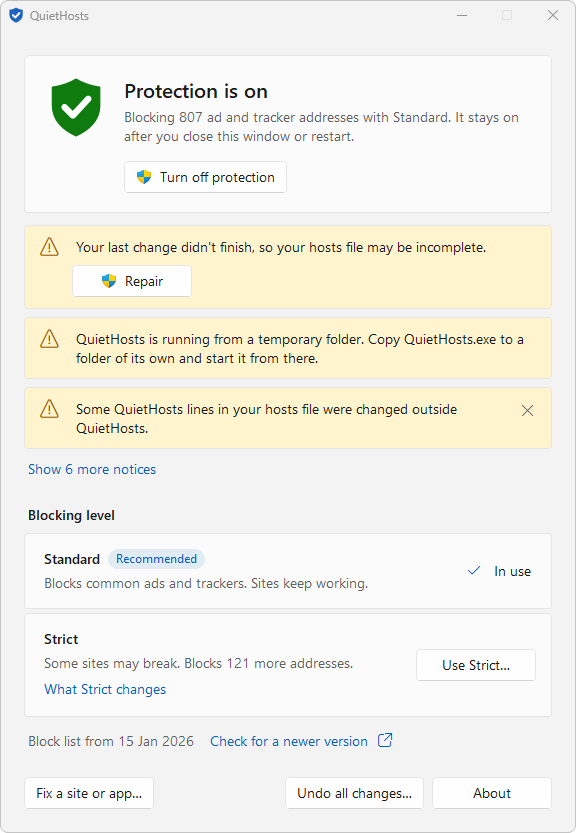
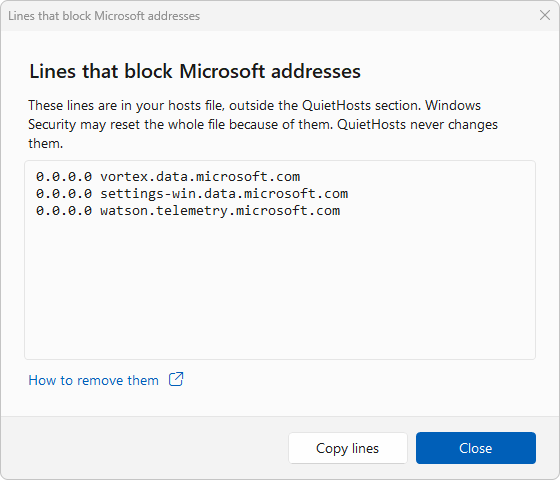
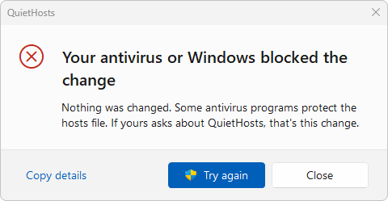

# Notices and messages

QuietHosts tells you in words what it found and what happened. This page lists every message it can show, what it means and what to do.

[User guide](README.md) › Notices and messages

## How notices work

Notices are the short bars under the status card. The result of your last change comes first, then warnings, then information, then tips.

<picture>
  <source media="(prefers-color-scheme: dark)" srcset="images/notices-dark.png">
  <source media="(prefers-color-scheme: light)" srcset="images/notices-light.png">
  
</picture>

- **At most three show at once.** If there are more, **Show 2 more notices** (or **Show 1 more notice**) shows the rest until you close QuietHosts.
- **Colors and icons.** Warnings are yellow with a warning triangle, results that worked are green with a check mark, and information and tips have a blue "i". In a contrast theme, the icon's shape and the words tell them apart. Screen readers read "Warning:", "Note:", "Tip:" or "Done:" first.
- **At most one button or link** in each notice.
- **Closing.** A notice with an X can be closed. A closed notice stays hidden until its cause changes, for example when other lines in the hosts file change. QuietHosts remembers this for your Windows user; **Undo all changes…** forgets it. Notices without an X go away by themselves once their cause is gone.
- **When they update.** When the window opens, after each change, and when QuietHosts reads the hosts file again (F5, **Check again** or **Try again**). Never while a change runs.

While protection is on, only one notice at a time offers **Repair**, **Use newer list** or **Remove it now**. All three make the same change, and that one change clears all of those notices.

## The status card

The card at the top says whether protection is on. Its button always names what it does next.

| Headline | Detail | Button |
|---|---|---|
| Protection is off | Ads and trackers aren't blocked. | **Turn on protection** |
| Protection is off | You turned it off to test a site. Turn it on again when you're done. (Only after **Turn off for now** in [Fix a site or app](fix-a-site.md#test-with-protection-off), until you close QuietHosts.) | **Turn on protection** |
| Protection is on | Blocking … ad and tracker addresses with Standard (or Strict). It stays on after you close this window or restart. If you allowed addresses, it adds how many, for example "(you allowed 3)". | **Turn off protection** |
| Protection was removed | The QuietHosts list is no longer in your hosts file. Windows Security, an antivirus or another program removed it. | **Turn on again**. See [Protection was removed](troubleshooting.md#protection-was-removed). |
| Older block list found | Your hosts file has … addresses from block-ads.ps1. Turning on replaces them with the QuietHosts list. | **Turn on protection** |
| Can't read your hosts file | Another program may be blocking it. Try again in a minute, or restart your PC. | **Try again** reads the file again. See [Can't read your hosts file](troubleshooting.md#cant-read-your-hosts-file). |
| QuietHosts won't change your hosts file | Windows is set to use a hosts file in another folder (…). Malware sometimes does this, so check your PC with your antivirus. | **Check again** reads the file again. See [QuietHosts won't change your hosts file](troubleshooting.md#quiethosts-wont-change-your-hosts-file). |
| QuietHosts won't change your hosts file | It's larger than 16 MB, usually because another program added a very large list. | **Check again** |
| QuietHosts can't change your hosts file | It's saved in a format QuietHosts can't change safely, such as UTF-16. Save it as UTF-8, then select Check again. The link **How to do this** opens the steps. | **Check again** |
| QuietHosts can't tell what's in your hosts file | Select Check again. If this stays, restart your PC. | **Check again** |

**Turn on protection**, **Turn off protection** and **Turn on again** show the Windows shield: Windows asks for your permission first. On the status card, **Try again** and **Check again** only read the file again and never ask. (The **Try again** in an [error window](#error-windows) is different: it makes the change again.)

## While a change runs

A line under the main button shows what is happening. The buttons that change the hosts file wait meanwhile; everything else keeps working.

| Message | What it means |
|---|---|
| Waiting for your permission. If you don't see the Windows prompt, check the taskbar. | Windows is showing its permission prompt. It may be behind other windows. |
| Changing the hosts file… | You said yes, and QuietHosts is making the change. This usually takes a few seconds. |
| This is taking longer than usual. If your antivirus asks about QuietHosts, that's this change. | The change has run for 30 seconds. Look for a message from your antivirus; it may be behind other windows. Allow it only if you just clicked a QuietHosts button. QuietHosts keeps waiting and shows the result when the change ends. |
| QuietHosts is already changing the hosts file. This window updates when it's done. | Another QuietHosts change is still running, for example one you started before you closed the window. See [QuietHosts is already changing the hosts file](troubleshooting.md#quiethosts-is-already-changing-the-hosts-file). |

## Results

After each change, its result is the first notice. You can close it. It also goes when the next change starts, when QuietHosts reads the hosts file again (F5, **Check again** or **Try again**) and when you close QuietHosts.

| Result | What to do |
|---|---|
| Protection is on and working. Restart your browser to see the change. | Restart your browser. |
| The list is in your hosts file, but QuietHosts couldn't confirm that Windows uses it yet. Restart your browser; if ads still show, restart your PC. | Do as it says. Its **Copy details** link copies details for a report. See [Ads still show](troubleshooting.md#ads-still-show). |
| Protection is off. Your level and allowed addresses are kept for next time. | Restart your browser, so it forgets that the addresses were blocked. |
| You're now using Standard. Restart your browser to see the change. (Or Strict.) | Restart your browser. |
| Updated to the block list from 20 Nov 2026. Restart your browser to see the change. | Restart your browser. See [Update QuietHosts](update.md). |
| Allowed 2 addresses. Restart your browser, then reload the page. | Restart your browser and reload the page. |
| Blocked 2 addresses again. Restart your browser to see the change. | Restart your browser. |
| Your hosts file is repaired. Restart your browser to see the change. | Restart your browser. (While protection is off, it says only "Your hosts file is repaired.") |
| The older block-ads.ps1 list is removed. Restart your browser to see the change. | Restart your browser. |
| Everything QuietHosts added is removed. To uninstall, delete QuietHosts.exe. | See [Uninstall](uninstall.md). |
| Nothing was changed. | You said no to the Windows prompt, or closed it. Try again whenever you like. |
| QuietHosts was already changing the hosts file. Try again in a moment. | Wait a moment, then click the button again. |
| Nothing was changed: the change would make your hosts file larger than 16 MB. | Other programs have filled the hosts file. Remove their lists, or [restore a backup](troubleshooting.md#restore-a-backup). |

In QuietHosts, these messages show your own numbers and dates.

## Warnings

| Notice | Why it shows | What to do | X |
|---|---|---|---|
| Your last change didn't finish, so your hosts file may be incomplete. | A change stopped halfway, for example because the PC turned off. | Click **Repair** (one Windows prompt). With protection on, it writes QuietHosts' lines again; with protection off, it removes what is left of them. Or click **Undo all changes…**, or [restore a backup](troubleshooting.md#restore-a-backup). Without a **Repair** button, your next change repairs the file. | No |
| QuietHosts is running from a temporary folder. Copy QuietHosts.exe to a folder of its own and start it from there. | You started QuietHosts from a temporary folder, for example from inside a zip file. | Do as it says. See [Put QuietHosts in a folder of its own](getting-started.md#put-quiethosts-in-a-folder-of-its-own). | No |
| Your hosts file has a newer block list (…). Changes made with this copy put an older list back. | You started an older QuietHosts.exe than the one that wrote your hosts file. | Use the newest QuietHosts.exe. **Get the newest QuietHosts** opens the releases page. | No |
| Some QuietHosts lines in your hosts file were changed outside QuietHosts. | Another program, or a person, edited the lines that QuietHosts manages. | Click **Repair** to write QuietHosts' lines again (one Windows prompt). Your next change fixes them too. | Yes |
| Another program added lines that block Microsoft addresses. Windows Security may reset your hosts file because of them, which also removes QuietHosts. | Lines outside QuietHosts' block block Microsoft's own services. QuietHosts never writes such lines. | Click **Show lines** to see them. Then see [Windows Defender reports HostsFileHijack](troubleshooting.md#windows-defender-reports-hostsfilehijack). | Yes |

**Show lines** opens "Lines that block Microsoft addresses". It shows the lines exactly as they are in your hosts file (up to 50; it says how many more there are). **Copy lines** copies them, and **How to remove them** opens the steps in your browser. QuietHosts never changes these lines itself.

<picture>
  <source media="(prefers-color-scheme: dark)" srcset="images/microsoft-lines-dark.png">
  <source media="(prefers-color-scheme: light)" srcset="images/microsoft-lines-light.png">
  
</picture>

## Information and tips

| Notice | Why it shows | What to do | X |
|---|---|---|---|
| This copy of QuietHosts has a newer block list (…). | You updated QuietHosts, and your hosts file still has the older list. | Click **Use newer list** (one Windows prompt). Protection stays on, and your level and allowed addresses are kept. See [Update QuietHosts](update.md). | Yes |
| Your hosts file still has the older block-ads.ps1 list. It's removed with your next change. | Your hosts file still has a block of lines from block-ads.ps1, an older script. | Click **Remove it now** (one Windows prompt), or wait for your next change. | Yes |
| Some QuietHosts marker lines are damaged. They're fixed with your next change. | The lines that start and end QuietHosts' block (`# >>> QuietHosts >>>` and `# <<< QuietHosts <<<`) are missing, doubled or out of order. | Click **Repair**, or wait for your next change. | Yes |
| Your hosts file is large (1.4 MB), mostly from other programs. Very large hosts files can slow Windows down. | The lines that other programs added take more than 256 KB. | If you don't need those lines, remove them or the program that added them. Once closed, this notice comes back only if the file grows by more than half. | Yes |
| Tip: QuietHosts is safer in a folder of its own than in Downloads. | QuietHosts.exe is in your Downloads folder. | Move it to a folder of its own. **Why?** explains it. See [Put QuietHosts in a folder of its own](getting-started.md#put-quiethosts-in-a-folder-of-its-own). | Yes |

## Error windows

When a change fails, or something goes wrong in QuietHosts itself, it opens a small window that says what happened. Every one has **Copy details**, which copies what a problem report needs: the versions, your Windows build and what went wrong. Your user folder shows as %USERPROFILE%, and the contents of your hosts file are never included.

<picture>
  <source media="(prefers-color-scheme: dark)" srcset="images/error-blocked-dark.png">
  <source media="(prefers-color-scheme: light)" srcset="images/error-blocked-light.png">
  
</picture>

| Heading | Text | Buttons |
|---|---|---|
| The hosts file is in use | Nothing was changed. Another program is using the hosts file. Wait a minute and try again; if it keeps happening, restart your PC. | **Try again**, **Close** |
| Your antivirus or Windows blocked the change | Nothing was changed. Some antivirus programs protect the hosts file. If yours asks about QuietHosts, that's this change. | **Try again**, **Close** |
| The change was undone right away | QuietHosts changed the hosts file, but another program put it back, most likely your antivirus. Look for a message from it about the hosts file. | **Try again**, **Close** |
| QuietHosts couldn't finish | Your hosts file wasn't changed. If this happens again, report it on GitHub and paste the details. | **Try again**, **Report on GitHub**, **Close** |
| QuietHosts couldn't finish | Your hosts file may be incomplete. Repair makes the same change again, or you can use Undo all changes. | **Repair**, **Report on GitHub**, **Close** |
| Something went wrong | QuietHosts ran into a problem, but your hosts file wasn't changed. If it keeps happening, report it on GitHub and paste the details. | **Report on GitHub**, **Close** |

- **Try again** and **Repair** make the same change again, with a new Windows prompt.
- **Report on GitHub** opens the problem form in your browser. Click **Copy details** first and paste the details into the form.
- [Troubleshooting](troubleshooting.md#your-antivirus-asks-about-quiethosts-or-blocks-the-change) explains what to do about antivirus programs.

If you say no to the Windows prompt, QuietHosts never shows an error: it says "Nothing was changed."

## A link or folder that doesn't open

Links in QuietHosts open in your browser, and **Open backup folder** opens File Explorer. If Windows can't open one, QuietHosts says "QuietHosts couldn't open the link" and "Copy this address into your browser:", or "QuietHosts couldn't open the folder" and "This is the folder:". Click **Copy**, then paste the address into your browser or File Explorer.
