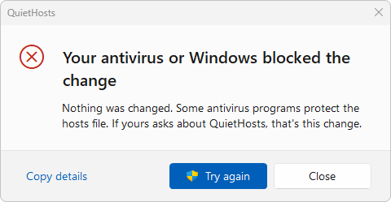
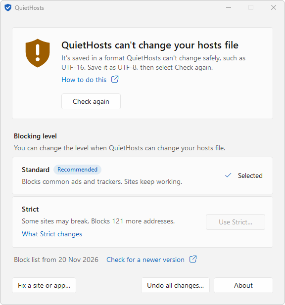

# Troubleshooting

Find your problem below. Each section says what QuietHosts shows, why, and what to do. For the meaning of every message, see [Notices and messages](notices.md).

[User guide](README.md) › Troubleshooting

- [Ads still show](#ads-still-show)
- [A site or app stopped working](#a-site-or-app-stopped-working)
- [The Windows prompt doesn't appear](#the-windows-prompt-doesnt-appear)
- [Windows asks for a password](#windows-asks-for-a-password)
- [Your antivirus asks about QuietHosts or blocks the change](#your-antivirus-asks-about-quiethosts-or-blocks-the-change)
- [Your antivirus warns about QuietHosts.exe](#your-antivirus-warns-about-quiethostsexe)
- [Windows Defender reports HostsFileHijack](#windows-defender-reports-hostsfilehijack)
- [Protection was removed](#protection-was-removed)
- [The hosts file is in use](#the-hosts-file-is-in-use)
- [QuietHosts is already changing the hosts file](#quiethosts-is-already-changing-the-hosts-file)
- [Can't read your hosts file](#cant-read-your-hosts-file)
- [QuietHosts won't change your hosts file](#quiethosts-wont-change-your-hosts-file)
- [QuietHosts can't tell what's in your hosts file](#quiethosts-cant-tell-whats-in-your-hosts-file)
- [A change didn't finish](#a-change-didnt-finish)
- [QuietHosts lines were changed outside QuietHosts](#quiethosts-lines-were-changed-outside-quiethosts)
- [QuietHosts doesn't start](#quiethosts-doesnt-start)
- [Smart App Control blocks QuietHosts](#smart-app-control-blocks-quiethosts)
- [Restore a backup](#restore-a-backup)
- [Open the hosts file as administrator](#open-the-hosts-file-as-administrator)
- [Report a problem](#report-a-problem)

## Ads still show

1. Check that the main window says "Protection is on".
2. Restart your browser: close all its windows, then open it again. Browsers remember addresses for a few minutes.
3. If QuietHosts said "The list is in your hosts file, but QuietHosts couldn't confirm that Windows uses it yet.", restart your browser; if ads still show, restart your PC. If ads still show after that, turn protection off and on again. If QuietHosts says it again, click **Copy details** in that notice and paste the details into a [problem report](https://github.com/quiethosts/QuietHosts/issues/new?template=bug.yml).
4. Some ads come from the same servers as the page itself, such as video ads on YouTube and Twitch and sponsored posts on social sites. A hosts file can't block those. Use an ad-blocking browser extension for them. See [What it can't block](how-it-works.md#what-it-cant-block).
5. QuietHosts has no effect when a browser or app uses a proxy, or in apps that look up addresses themselves instead of asking Windows.

Strict blocks more addresses than Standard, with some trade-offs (see [Blocking levels](blocking-levels.md#strict)). To suggest an address that QuietHosts should block, read [CONTRIBUTING.md](../CONTRIBUTING.md#the-block-lists).

## A site or app stopped working

Click **Fix a site or app…** in QuietHosts and try its steps in order: restart your browser, try Standard (if you use Strict), and test with protection off. If QuietHosts is the cause, you can allow the addresses the site needs. [Fix a site or app](fix-a-site.md) shows every step.

## The Windows prompt doesn't appear

QuietHosts says "Waiting for your permission. If you don't see the Windows prompt, check the taskbar."

- The prompt may be behind other windows, or only flashing on the taskbar. Click it there.
- QuietHosts waits as long as the prompt is open. If you close the prompt or say no, QuietHosts says "Nothing was changed." Click the button again to try again.

## Windows asks for a password

Your Windows account isn't an administrator. Each change needs an administrator's permission, so Windows asks for an administrator's password. Ask the person who manages this PC. Without that permission, QuietHosts can't change anything.

Some PCs ask for a PIN, a fingerprint or your face instead. That's normal.

## Your antivirus asks about QuietHosts or blocks the change

Some antivirus programs protect the hosts file. Then QuietHosts says "Your antivirus or Windows blocked the change" or "The change was undone right away".

<picture>
  <source media="(prefers-color-scheme: dark)" srcset="images/error-blocked-dark.png">
  <source media="(prefers-color-scheme: light)" srcset="images/error-blocked-light.png">
  
</picture>

1. [Check your download](getting-started.md#check-your-download), so you know the file is genuine.
2. Look for a message from your antivirus about the hosts file. If it asks about QuietHosts, that's this change. Allow it only if you just clicked a QuietHosts button.
3. Click **Try again**.

If QuietHosts says "This is taking longer than usual. If your antivirus asks about QuietHosts, that's this change.", look for that message (it may be behind other windows). Allow it only if you just clicked a QuietHosts button. QuietHosts keeps waiting and shows the result when the change ends.

QuietHosts never changes your antivirus settings, and it never asks you to turn any protection off.

## Your antivirus warns about QuietHosts.exe

If your antivirus warns about QuietHosts.exe itself, [check the hash](getting-started.md#check-your-download) first. If it doesn't match, don't run the file.

New programs that aren't signed and that change the hosts file can trigger false alarms. Please [report it](https://github.com/quiethosts/QuietHosts/issues/new?template=bug.yml) with the name of your antivirus and the name of the detection, so the antivirus maker can be asked to fix it.

## Windows Defender reports HostsFileHijack

Windows Defender reports SettingsModifier:Win32/HostsFileHijack when the hosts file blocks Microsoft addresses. QuietHosts never blocks them, but another program, or an old edit, may have. Defender may then reset the whole hosts file, including QuietHosts' lines. QuietHosts then says "Protection was removed".

1. [Open the hosts file as administrator](#open-the-hosts-file-as-administrator).
2. Look for lines that don't start with `#` and block one of Microsoft's own services, for example an address ending in microsoft.com, windows.com, windowsupdate.com, live.com or bing.com. They are usually outside the QuietHosts block; QuietHosts never adds them itself. QuietHosts warns about the lines that can make Defender reset the file: "Another program added lines that block Microsoft addresses. Windows Security may reset your hosts file because of them, which also removes QuietHosts." Click **Show lines** in that notice to see them (and copy them); its **How to remove them** link opens these steps. It doesn't warn about lines for names that ad and phishing lists often block, such as adnxs.com, GitHub pages or sites hosted on Azure (azurewebsites.net).
3. Delete those lines and save. If a program added them, it may add them again, so consider removing that program.
4. In QuietHosts, click **Turn on again**.

## Protection was removed

QuietHosts says "Protection was removed" and "The QuietHosts list is no longer in your hosts file. Windows Security, an antivirus or another program removed it."

Your settings say that protection is on, but QuietHosts' lines are gone from the hosts file. Common causes:

- Windows Security reset the hosts file because of other lines in it. If QuietHosts also shows the notice about lines that block Microsoft addresses, follow [Windows Defender reports HostsFileHijack](#windows-defender-reports-hostsfilehijack) first.
- An antivirus or another program put back an older hosts file.
- Someone restored a backup of the hosts file.

Click **Turn on again** (one Windows prompt). If protection keeps disappearing, look in your antivirus's reports for what reset the hosts file.

## The hosts file is in use

If QuietHosts says "The hosts file is in use": another program is using the hosts file, so nothing was changed. Wait a minute and click **Try again**; if it keeps happening, restart your PC.

## QuietHosts is already changing the hosts file

If QuietHosts says "QuietHosts is already changing the hosts file. This window updates when it's done.", a change started earlier is still running, for example one you started before you closed the window. The buttons that change the hosts file come back by themselves when it ends. If it doesn't end within a few minutes, look for a message from your antivirus about QuietHosts (see [Your antivirus asks about QuietHosts or blocks the change](#your-antivirus-asks-about-quiethosts-or-blocks-the-change)), or restart your PC.

If a change result says "QuietHosts was already changing the hosts file. Try again in a moment.", wait a moment and click the button again.

## Can't read your hosts file

QuietHosts says "Can't read your hosts file" and "Another program may be blocking it. Try again in a minute, or restart your PC."

1. Wait a minute, then click **Try again**. It only reads the file again; Windows doesn't ask for permission.
2. If it stays, restart your PC and start QuietHosts again.
3. If it still stays, [report a problem](#report-a-problem).

Until QuietHosts can read the file, it changes nothing, and the level buttons are greyed out.

## QuietHosts won't change your hosts file

QuietHosts refuses to change the hosts file when that isn't safe, and it tells you why. The headline says "QuietHosts won't change your hosts file" or, for the file format, "QuietHosts can't change your hosts file".

<picture>
  <source media="(prefers-color-scheme: dark)" srcset="images/cant-change-dark.png">
  <source media="(prefers-color-scheme: light)" srcset="images/cant-change-light.png">
  
</picture>

- **Windows is set to use a hosts file in another folder.** Malware sometimes does this, so QuietHosts leaves it alone. Check your PC with your antivirus. The setting is the DataBasePath value in `HKEY_LOCAL_MACHINE\SYSTEM\CurrentControlSet\Services\Tcpip\Parameters`.
- **The file is saved in a format QuietHosts can't change safely, such as UTF-16.** [Open it in Notepad as administrator](#open-the-hosts-file-as-administrator). Choose **File > Save as**, set the encoding to **UTF-8** and the type to **All files**, and save it as `hosts`. Then click **Check again**.
- **The file is larger than 16 MB.** Another program probably added a very large list. Remove that list, or [restore a backup](#restore-a-backup). Then click **Check again**.

**Check again** only reads the file again; Windows doesn't ask for permission.

## QuietHosts can't tell what's in your hosts file

QuietHosts says "QuietHosts can't tell what's in your hosts file" and "Select Check again. If this stays, restart your PC."

Click **Check again**. If it stays after a restart, [report a problem](#report-a-problem).

## A change didn't finish

If QuietHosts says "Your last change didn't finish, so your hosts file may be incomplete.", click **Repair** in that notice (one Windows prompt), or click **Undo all changes…**. If an error window says "QuietHosts couldn't finish" and "Your hosts file may be incomplete", click **Repair** there: it makes the same change again. You can also [restore a backup](#restore-a-backup).

## QuietHosts lines were changed outside QuietHosts

QuietHosts says "Some QuietHosts lines in your hosts file were changed outside QuietHosts." Another program, or a person, edited the lines between `# >>> QuietHosts >>>` and `# <<< QuietHosts <<<`. QuietHosts noticed because their checksum no longer matches. The lines may still block, but they are no longer exactly what QuietHosts wrote.

Click **Repair** in that notice (one Windows prompt). QuietHosts writes its lines again; lines outside its block stay as they are. Any other change, such as switching the level, fixes them too.

To unblock an address, don't edit QuietHosts' lines: allow the address in [Fix a site or app](fix-a-site.md#allow-an-address).

## QuietHosts doesn't start

- **Windows protected your PC:** see [Start QuietHosts](getting-started.md#start-quiethosts).
- **Nothing happens:** QuietHosts may already be open. Starting it again brings its window to the front; look for it on the taskbar.
- **A message says "Something went wrong":** QuietHosts couldn't start its window. The message shows the error. Your hosts file wasn't changed. Please [report it](#report-a-problem) with the error.
- **Your Windows is too old:** QuietHosts needs Windows 10 (version 1903 or later) or Windows 11.

## Smart App Control blocks QuietHosts

On Windows 11, Smart App Control blocks unsigned apps that have no reputation yet, and it has no **Run anyway** button. Then QuietHosts can't run on that PC for now. We don't recommend turning Smart App Control off for it. Signed builds are planned.

## Restore a backup

Before every change, QuietHosts saves a copy of the hosts file in the same folder, `C:\Windows\System32\drivers\etc`. In QuietHosts, **About > Open backup folder** opens it.

- `hosts.quiethosts-original.bak` is your hosts file as it was before QuietHosts changed it the first time. QuietHosts never overwrites or deletes it. If **Copy details** ever says "partial backup left" for this file, don't put it back; use the oldest `hosts.quiethosts-<date>-<time>.bak` instead.
- `hosts.quiethosts-<date>-<time>.bak` is a copy from just before a change. QuietHosts keeps the 10 newest. The date and time in the name are in UTC, not your local time.

To put a backup back:

1. Click Start and type **cmd**. Right-click **Command Prompt**, choose **Run as administrator** and click **Yes**.
2. Run these two commands. To use another backup, change the file name in the first one.

   ```
   copy /y "%SystemRoot%\System32\drivers\etc\hosts.quiethosts-original.bak" "%SystemRoot%\System32\drivers\etc\hosts"
   ipconfig /flushdns
   ```

3. Restart your browser.

This replaces the whole hosts file, so changes made after that backup are lost. If QuietHosts then says "Protection was removed", click **Turn on again**, or **Undo all changes…**.

## Open the hosts file as administrator

1. Click Start and type **Notepad**.
2. Right-click **Notepad**, choose **Run as administrator** and click **Yes**.
3. In Notepad, choose **File > Open**.
4. In **File name**, paste `C:\Windows\System32\drivers\etc\hosts` and click **Open**.

After you save a change, run `ipconfig /flushdns` in Command Prompt and restart your browser.

Lines that start with `#` are comments. Leave the lines between `# >>> QuietHosts >>>` and `# <<< QuietHosts <<<` to QuietHosts.

## Report a problem

- **Something in QuietHosts doesn't work:** use [Report a problem](https://github.com/quiethosts/QuietHosts/issues/new?template=bug.yml), which is also in About. If QuietHosts showed an error, click **Copy details** in that error window (every one has it); if it said it couldn't confirm that Windows uses the list, click **Copy details** in that notice. Paste the details into the form. They list the versions, your Windows build and what went wrong. Your user folder shows as %USERPROFILE%.
- **A site or app broke:** use the [broken-site form](https://github.com/quiethosts/QuietHosts/issues/new?template=site-broke.yml). In QuietHosts, **Copy details** in **Fix a site or app…** copies what the form asks about QuietHosts.
- **A security problem:** please report it privately, as [SECURITY.md](../SECURITY.md) describes.

Reports are public. Don't include your name, email address or other personal information. You need a GitHub account to post one. [SUPPORT.md](../SUPPORT.md) lists every way to get help.
