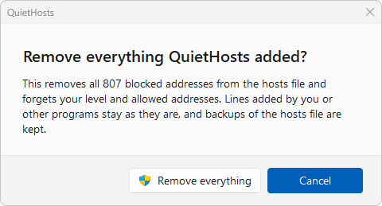

# Uninstall QuietHosts

Click Undo all changes, then delete QuietHosts.exe. There is no installer and nothing else to remove.

[User guide](README.md) › Uninstall

## Remove QuietHosts

1. In QuietHosts, click **Undo all changes…**.
2. QuietHosts asks "Remove everything QuietHosts added?" and says what it removes and what it keeps. Click **Remove everything**. (**Cancel** keeps everything as it is.)
3. Say yes to the Windows prompt if it names QuietHosts.exe.
4. QuietHosts says "Everything QuietHosts added is removed. To uninstall, delete QuietHosts.exe."
5. Close QuietHosts and restart your browser.
6. Delete QuietHosts.exe, and its folder if you made one for it.

<picture>
  <source media="(prefers-color-scheme: dark)" srcset="images/undo-dark.png">
  <source media="(prefers-color-scheme: light)" srcset="images/undo-light.png">
  
</picture>

## What Undo removes and what it keeps

**Undo all changes…** removes:

- QuietHosts' lines from the hosts file (and the older block-ads.ps1 list, if your hosts file has one);
- QuietHosts' settings for the whole PC: whether protection is on, your level, your allowed addresses and the record of the last change;
- your own QuietHosts settings: window positions and sizes, the level you picked while protection was off, which notices you closed, and whether you have seen the first screen.

It keeps:

- every line that you or other programs added to the hosts file;
- the backups of the hosts file, in case you need them.

## Delete the backups

The backups (`hosts.quiethosts-*.bak`) stay in `C:\Windows\System32\drivers\etc`. To delete them:

1. Open that folder in File Explorer.
2. Select the files whose names start with `hosts.quiethosts-`.
3. Delete them. Windows asks for administrator permission.

Don't delete the file named `hosts`.

## If Undo all changes… is greyed out

Then there is nothing in the hosts file or the PC-wide settings for it to undo: just delete QuietHosts.exe. To remove its window settings too, run `reg delete "HKCU\Software\QuietHosts" /f` in Command Prompt.

The button is also greyed out while a change runs. It comes back when the change ends.

## Other Windows users

Each Windows user who opened QuietHosts has their own small settings key. **Undo all changes…** deletes only yours. The others do nothing without the app. To remove them too, each user can run `reg delete "HKCU\Software\QuietHosts" /f` in Command Prompt.

## Remove QuietHosts without the app

If you already deleted QuietHosts.exe:

1. [Open the hosts file as administrator](troubleshooting.md#open-the-hosts-file-as-administrator).
2. Delete the line `# >>> QuietHosts >>>`, the line `# <<< QuietHosts <<<` and every line between them. Save the file.
3. Open Command Prompt and run `ipconfig /flushdns`. Then restart your browser.
4. If you want, delete QuietHosts' settings too. In Command Prompt run as administrator, run `reg delete "HKLM\SOFTWARE\QuietHosts" /f`. In a normal Command Prompt, run `reg delete "HKCU\Software\QuietHosts" /f`.

Deleting QuietHosts.exe alone doesn't stop the blocking: Windows keeps reading the lines in the hosts file until they are removed.
